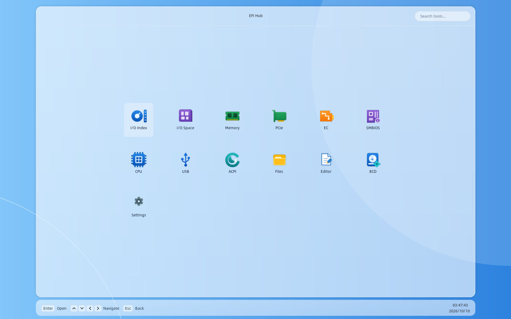

# EFIHub

[English](README_EN.md)

EFIHub 是一个运行在 UEFI/EFI 环境中的图形化硬件调试与系统工具集合，基于 LVGL 构建，目标是在没有操作系统的环境下，也能提供相对现代、直观的图形界面和常用底层调试能力。

当前版本：**v0.2**。

## 界面截图



## v0.2 更新

- 修复部分平台外接 USB 键盘无法操作的问题，统一读取固件控制台输入。
- 新增 F12 / Print Screen 截图，自动保存 BMP 文件。
- 默认关闭键盘及 USB 枚举 TXT 诊断日志。

## 当前功能

- I/O Index
- I/O Space
- Memory
- PCIe
- EC
- SMBIOS
- CPU
  - Overview
  - MSR
  - CPUID
- USB
- ACPI
- Files
- Text Editor
  - 文件编辑
  - 搜索
  - 拼音输入法
- BCD
- Settings

## 设计特点

- 运行于 UEFI/EFI 环境
- 基于 LVGL 8
- 浅色、简约、毛玻璃风格界面
- Mini App 式功能组织
- 统一键盘导航和状态栏快捷键提示
- 支持文件管理与文本编辑
- 支持常见底层硬件寄存器和固件数据查看

## 键盘操作

EFIHub 主要面向键盘操作，底部状态栏会根据当前 Mini App 显示可用快捷键。

常用操作包括：

- `Tab`：切换控件
- `方向键`：移动 / 导航
- `Enter`：进入 / 编辑 / 确认
- `Esc`：返回
- `F6`：RegTable 位宽切换
- `Win + Up/Down`：部分 Mini App 全屏切换
- `Ctrl + Space`：文本编辑器中英文输入法切换
- `F12` / `Print Screen`：截图，保存到应用所在磁盘的 `\Screenshots\Screenshot-0001.bmp`，编号自动递增。Print Screen 需要固件上报 SysRq 按键状态。

## 下载

请前往 [GitHub Releases](https://github.com/uefibin/EFIHub/releases/latest) 下载最新版本：

- `EH_X64.efi`：X64 UEFI 应用

## 运行

将 `EH_X64.efi` 放入 EFI System Partition 或 U 盘中的 FAT32 分区，然后在 UEFI Shell 中运行：

```text
EH_X64.efi
```

## 注意事项

- 这是直接运行在固件环境中的底层工具，部分功能会访问硬件寄存器、I/O、PCIe、EC 等资源。
- 不同平台的 UEFI/GOP 实现存在差异，显示效果和硬件访问能力可能不同。
- 建议先在测试机上使用。

## 关于

- 名称：EFIHub
- 作者：bin
- 公众号：UEFI那点事
- 博客：https://ay123.net

